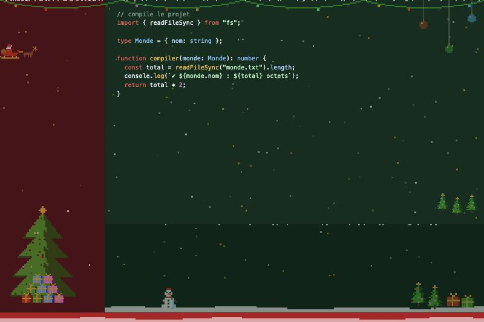
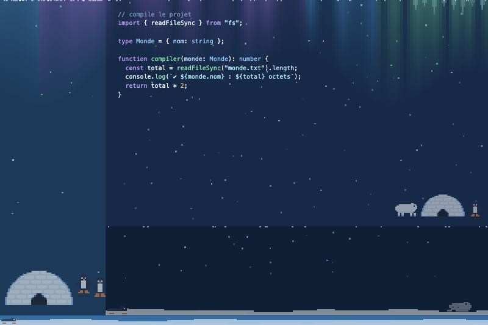
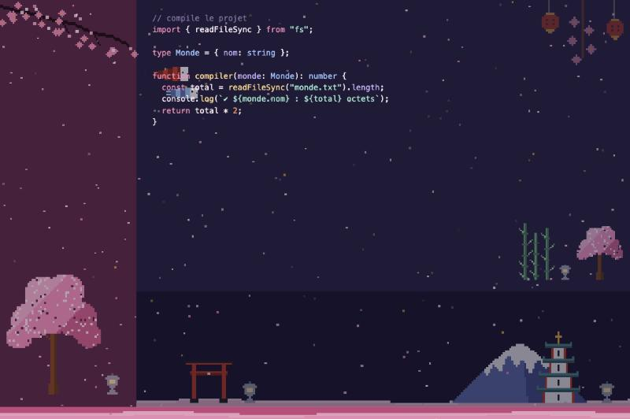
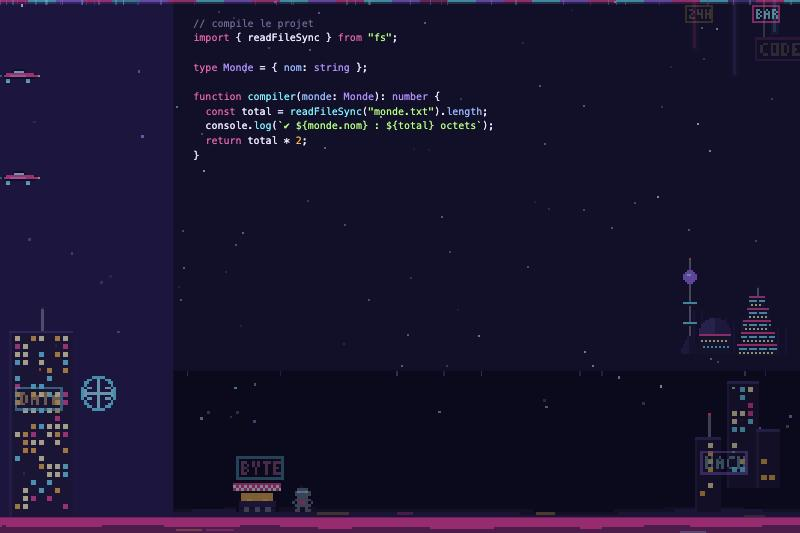
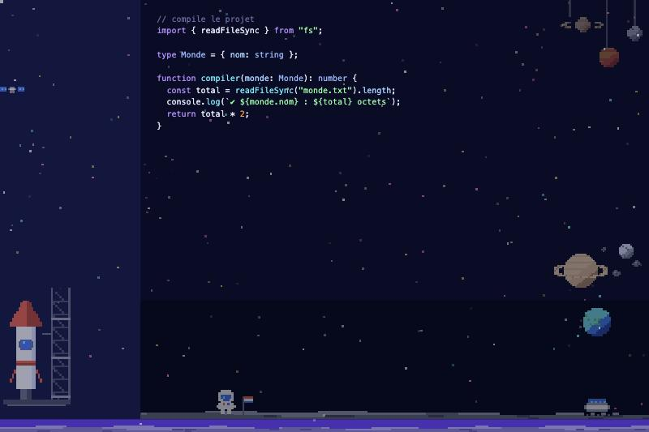
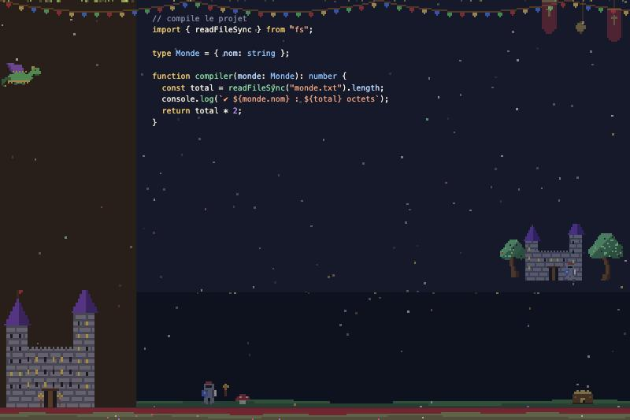
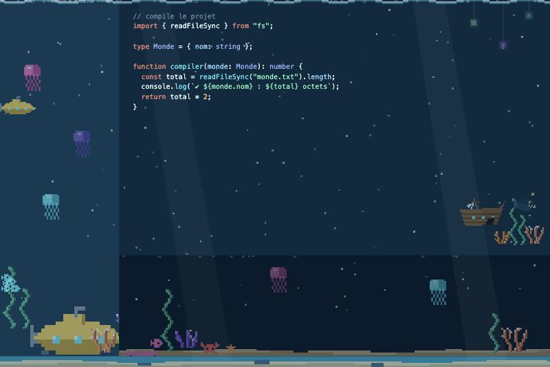
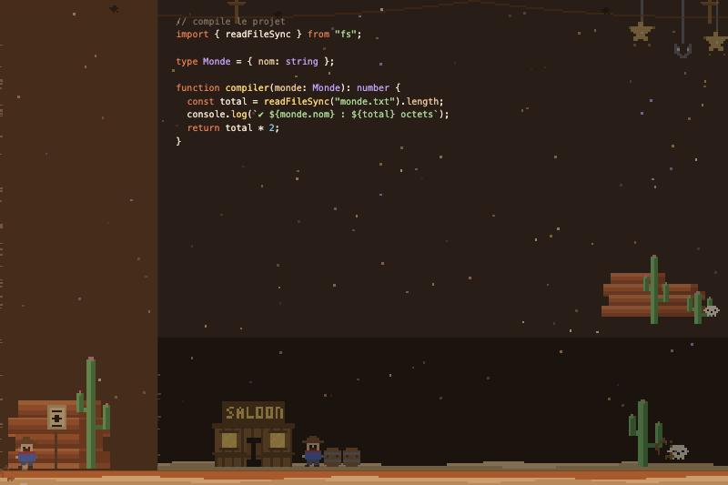

# 🌍 Pixel Worlds — Tous les mondes pixel art

**Une collection de mondes pixel art 8 bits pour VS Code : tu choisis ton monde en un clic, sans gêner ton code. De nouveaux mondes arrivent régulièrement.**

| 🎄 Noël | 🐧 Pôle Nord |
| --- | --- |
|  |  |

| 🌸 Sakura | 🌃 Néon City |
| --- | --- |
|  |  |

| 🚀 Espace | 🏰 Fantasy |
| --- | --- |
|  |  |

| 🌊 Océan | 🤠 Far West |
| --- | --- |
|  |  |

## 🌎 Les mondes

### 🎄 Noël
- Thème vert sapin et rouge Noël, code aux couleurs des guirlandes
- Neige qui tombe, traîneau du Père Noël qui traverse l'écran, sapins, cadeaux, bonhomme de neige
- 🌠 **Une étoile filante** explose à l'écran quand ta compilation réussit
- 🎅 **« Ho ho ho »** grave quand une commande échoue

### 🤠 Far West
- Thème coucher de soleil sur le désert : code en orange, or, vert cactus et ciel
- Un fil télégraphique avec des corbeaux, de la poussière portée par le vent, un **train à vapeur** et une **boule d'herbe** qui roulent à travers l'écran
- Un **saloon**, un cowboy, des barils, de grands cactus saguaro, des mesas rouges, un crâne de vache, une affiche « WANTED »
- Des étoiles de shérif et des fers à cheval qui se balancent
- 🧨 **Un bâton de dynamite est lancé en arc**, sa mèche crépite, il explose en nuage de poussière et un chapeau de cowboy vole quand ta compilation réussit
- 🔫 **Un coup de feu avec son écho dans le canyon** quand une commande échoue

### 🌊 Océan
- Thème bleu des profondeurs, code en corail, aqua, écume et sable doré
- Des rayons de lumière qui descendent de la surface, des bulles qui montent, des **méduses lumineuses** qui flottent
- Un **sous-marin** jaune qui traverse l'écran, des bancs de poissons, une épave, un poisson-lanterne, des algues qui ondulent, du corail, un crabe
- 🚢 **Un sous-marin tire une torpille** qui explose en bulles et fait fuir les poissons quand ta compilation réussit
- 📡 **Un ping de sonar** quand une commande échoue

### 🏰 Fantasy
- Thème nuit de château, avec le code en or, émeraude et corail sur fond de parchemin
- Des fanions colorés en haut de l'écran, de l'herbe en bas, des lucioles qui montent doucement
- Un **dragon** qui survole l'écran en battant des ailes, un grand château aux toits violets, des arbres enchantés
- Un chevalier, une torche qui vacille, des champignons magiques et un coffre au trésor dans le terminal
- 🔥 **Un dragon crache du feu** et le jet explose en boule de feu quand ta compilation réussit
- 🐉 **Un rugissement** quand une commande échoue

### 🚀 Espace
- Thème bleu nuit cosmique avec accents violet nébuleuse, cyan et orange fusée
- Des étoiles qui scintillent, des étoiles filantes qui traversent le ciel, un satellite et un sol lunaire gris
- Une planète à anneaux, une lune, des astéroïdes et la Terre au loin
- Une grande **fusée sur son pas de tir** avec sa tour de lancement, un **astronaute** avec son drapeau et un rover
- 🚀 **Une fusée décolle** avec sa flamme et sa fumée quand ta compilation réussit, puis libère un feu d'artifice d'étoiles
- 🚨 **Une alarme de vaisseau** quand une commande échoue

### 🌃 Néon City
- Thème nuit violette avec néons magenta, cyan et ambre : mots-clés en magenta, fonctions en cyan, textes en vert acide
- De la pluie qui tombe en diagonale, un rail de néon en haut de l'écran et des enseignes qui grésillent (BAR, 24H, CODE…)
- Une skyline de gratte-ciel aux fenêtres allumées, une grande tour avec un hologramme, un stand de nouilles et un petit robot
- Des **voitures volantes** qui traversent l'écran
- 🚗 **Une voiture volante** part du coin en bas à gauche, traverse l'écran et explose en étincelles quand ta compilation réussit
- 🔊 **Un buzzer 8 bits** quand une commande échoue

### 🌸 Sakura
- Thème indigo et rose sakura, avec le code en rose, or et matcha
- Pétales de cerisier qui tombent, branche en fleurs en haut à gauche, tapis de pétales au sol
- Torii rouge, pagode, mont Fuji, lanternes de pierre et chōchin, et des **koinobori** (carpes en tissu) qui traversent l'écran
- 🎆 **Un feu d'artifice (hanabi)** éclate en pétales quand ta compilation réussit
- 🎶 **Un koto suivi d'un gong** quand une commande échoue

### 🐧 Pôle Nord
- Thème bleu glace, aurore boréale verte et violette qui ondule
- Igloo, ours polaire, phoque, banquise, stalactites de glace
- Des **pingouins qui glissent sur le ventre** le long du terminal
- ❄️ **Une boule de neige** est lancée depuis le coin en bas à gauche et explose en neige quand ta compilation réussit
- 🐧 **Cri de pingouin** quand une commande échoue

Tout est volontairement **discret** : ton code reste parfaitement lisible. Les sons sont courts (moins de 2 secondes) et se coupent dans les réglages.

> 💻 Fonctionne sur **Mac, Windows et Linux**.

## 🚀 Installation

1. Clique sur **Install** en haut de cette page.
2. VS Code te demande : **« Choisis ton monde »**. Clique sur celui que tu veux.
3. La fenêtre se recharge : c'est prêt ! 🎉

## 🎛️ Commandes

Ouvre la palette avec `Cmd+Shift+P` (Mac) ou `Ctrl+Shift+P` (Windows / Linux) :

| Commande | Effet |
| --- | --- |
| `Pixel Worlds: Choisir un monde` | Change de monde (ou retire les décorations) |
| `Pixel Worlds: Retirer les décorations` | Enlève tout (le thème de couleurs reste) |
| `Pixel Worlds: Voir l'animation de compilation` | Lance l'animation pour l'essayer |
| `Pixel Worlds: Écouter le son d'erreur` | Joue le son pour l'essayer |
| `Pixel Worlds: Réparer l'animation de compilation` | Remet l'animation en place (après une mise à jour de VS Code) |
| `Pixel Worlds: Diagnostic` | Explique pourquoi quelque chose ne marche pas |

Pour couper le son ou l'animation : réglages (`Cmd+,` sur Mac, `Ctrl+,` ailleurs), cherche **Pixel Worlds**.

## ❓ Questions fréquentes

**Je ne vois pas l'animation de compilation.**
1. Quitte **complètement** VS Code (`Cmd+Q` sur Mac) et rouvre-le : c'est nécessaire la première fois.
2. Lance `Pixel Worlds: Voir l'animation de compilation` pour l'essayer.
3. Rien ? Lance `Pixel Worlds: Réparer l'animation de compilation`, puis redémarre.
4. Toujours rien ? Lance `Pixel Worlds: Diagnostic` : il te dit ce qui bloque (barre d'état masquée, intégration du terminal désactivée…).

L'animation se déclenche quand une **compilation réussit** (tâche de build, ou commande du terminal comme `make`, `gcc`, `tsc`, `npm run build`…). Elle a besoin que la barre d'état en bas soit visible.

**VS Code dit « Your installation appears to be corrupt ».**
C'est normal : les décorations passent par l'extension [Background](https://marketplace.visualstudio.com/items?itemName=shalldie.background), qui modifie légèrement VS Code pour afficher les images. Clique sur « Don't show again ». Rien n'est cassé.

**J'avais déjà « Noël Pixel 8-bit ».**
Pixel Worlds contient déjà le monde Noël : désinstalle l'ancienne extension pour éviter les doublons.

**Sur Linux, je n'entends pas le son.**
L'extension utilise `paplay`, `aplay`, `play`, `ffplay` ou `mpv`. Installe-en un (par exemple `sudo apt install pulseaudio-utils`).

**VS Code est installé dans un dossier protégé (Windows : Program Files, Linux : /usr/share).**
Les animations modifient un fichier de VS Code, ce qui demande les droits d'écriture. Utilise l'installation « utilisateur » de VS Code, ou lance VS Code une fois en administrateur.

## 🎧 Crédits

- 🐧 **Cri de pingouin papou** : [sounddino.com](https://sounddino.com/fr/effects/penguin-sounds/) (site de sons gratuits, libres de droits et sans attribution requise ; crédit donné par courtoisie).
- 🎅 Le « Ho ho ho » du monde Noël est créé pour l'extension.

## ❤️ Merci

Les décorations s'appuient sur l'excellente extension [Background](https://marketplace.visualstudio.com/items?itemName=shalldie.background) de shalldie, installée automatiquement avec Pixel Worlds.

Bon code ! 🐧🎄
